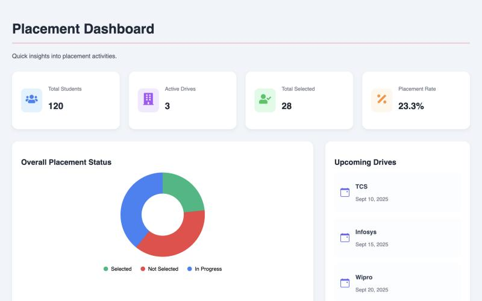

# E-Placement Hub

Frontend prototype of a college placement-cell dashboard. It gives placement coordinators an at-a-glance view of student placement status and upcoming recruitment drives.



## Features

- Summary cards for total students, active drives, students selected and overall placement rate
- Doughnut chart of placement status (Selected / Not Selected / In Progress) built with Chart.js
- Upcoming recruitment drives list
- Component scaffolding for creating and tracking drives (`CreateDrive`, `DriveTracking`, `AdminDashboard`)

The dashboard currently runs on sample data from `src/data/dashboardData.js` and in-page constants. There is no backend yet.

## Tech Stack

React 18, Vite, React Router, Chart.js (`react-chartjs-2`), React Icons, plain CSS.

## Running Locally

```bash
npm install
npm run dev
```

Open http://localhost:5173. For a production build, run `npm run build`.

## Project Structure

```text
src/
  components/   Stat cards, doughnut chart, drives list, drive forms
  pages/        DashboardPage and its styles
  data/         Sample dashboard data
```

## Contributors

- [Orphyxz](https://github.com/Orphyxz)
- Purvika
